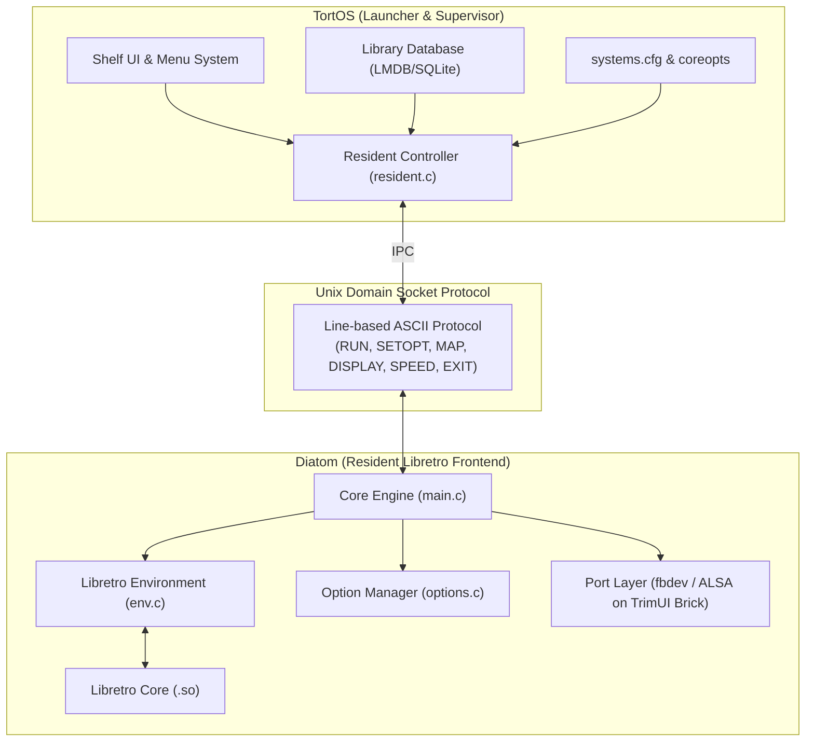

# TortOS & Diatom Architecture & Customizations

This document explains the architecture of TortOS and Diatom, detailing the modifications made for **SNK Neo Geo (FBNeo)** integration and **Game Boy live palette cycling (L1/R1)**, including the design rationale, inter-process communication, and rebuild instructions.

---

## 1. System Architecture Overview

TortOS and Diatom operate as two cooperating processes connected by a Unix domain socket:



### Component Responsibilities
- **TortOS (`/Users/joe/misc/TortOS`)**:
  - Manages the shelf UI, box art, system menus, Wi-Fi, and RetroAchievements.
  - Owns persistent state in the database (`db.c`): screen display modes, volume/brightness levels, and system-specific core options (`coreopt.<tag>.<key>`).
  - Launches games by issuing `RUN` messages to Diatom over a resident Unix domain socket.
- **Diatom (`/Users/joe/misc/diatom`)**:
  - Minimalist, high-performance Libretro frontend written in C for low-power ARM Linux handhelds (TrimUI Brick, GKD Pixel 2).
  - Handles frame pacing, audio resampling, physical button polling, and core lifecycle.
  - Keeps cores resident in memory to avoid cold startup overhead between launches.

---

## 2. SNK Neo Geo System & FBNeo Core Integration

### Objective
Enable SNK Neo Geo arcade/AES emulation on the TrimUI Brick using the FinalBurn Neo (`fbneo_libretro.so`) core.

### Changes & Design Rationale

#### A. Shelf Configuration (`TortOS/config/systems.cfg`)
```ini
sys|Neo Geo|Neo Geo|fbneo|NEOGEO|NEOGEO.png|D9A928|zip,7z
```
- **Tag**: `NEOGEO` (used to key display settings and core options).
- **ROM Directory**: `Roms/Neo Geo` (supports `.zip` and `.7z` arcade archive sets).
- **Core**: `fbneo` (`fbneo_libretro.so`).
- **Accent Color**: `#D9A928` (Neo Geo arcade cabinet gold).

#### B. Core Option Defaults (`TortOS/src/db.c`)
```c
{ "coreopt.NEOGEO.fbneo-neogeo-mode", "AES_EUR" },
```
- **Rationale**: Sets the Neo Geo BIOS mode to European/English AES console mode by default. Console mode provides English text, game selection menus, and avoids UniBIOS (which is banned from RetroAchievements hardcore mode).

#### C. Diatom ROM Loading & Block Extraction (`diatom/src/core.c`)
- **Branch**: `feature/fbneo-block-extract` (commit `4483620`)
- **Problem**: Arcade cores like FBNeo require multi-file ROM archive parsing (`RETRO_ENVIRONMENT_GET_VFS_INTERFACE` or in-memory extraction). Cores that load block content directly failed if Diatom attempted standard file streaming.
- **Solution**: Diatom was enhanced to extract and feed archive blocks correctly to cores expecting whole-archive ROM loading.

---

## 3. Game Boy Live Palette Cycling via L1 / R1

### Objective
Provide instant, on-the-fly Game Boy monochrome palette switching using the handheld's shoulder buttons during gameplay, matching Gambatte behavior.

### Why L1 and R1?
The original monochrome Game Boy (DMG) hardware possessed only D-pad, A, B, Select, and Start. The L1 and R1 shoulder buttons on the TrimUI Brick are otherwise unused during Game Boy emulation, making them ideal dedicated hotkeys.

```mermaid
sequenceDiagram
    autonumber
    actor Player
    participant Port as Diatom Input
    participant Main as Diatom (main.c)
    participant Opt as Diatom Options (options.c)
    participant Core as mGBA Core (libretro.c)

    Player->>Port: Presses R1 Shoulder Button
    Port->>Main: Button state edge detected
    Note over Main: Checks is_gb == true && MENU not held
    Main->>Opt: Step palette index (0..14)
    Main->>Opt: diatom_options_set("mgba_gb_colors", name)
    Opt->>Opt: Sets g_active->dirty = true
    Core->>Main: Next video frame: RETRO_ENVIRONMENT_GET_VARIABLE_UPDATE
    Main-->>Core: Returns true (diatom_options_take_update)
    Core->>Opt: Reads new mgba_gb_colors string
    Core->>Core: reloadConfigOption("gb.pal")
    Core-->>Player: Frame rendered with new color palette
```

### Changes & Implementation Details

#### A. Session Tag Propagation (`diatom/src/main.c`)
TortOS already sends `tag=GB` in its `RUN` message. Diatom was updated to record this tag in `diatom_session`:
```c
typedef struct diatom_session {
    ...
    const char   *tag;        /* system tag from launcher, e.g. "GB" */
    ...
} diatom_session;

/* Inside resident message poll: */
sn.tag = m.tag[0] ? m.tag : NULL;
```

#### B. Game Boy Identification
Works seamlessly in both TortOS resident mode and standalone CLI mode:
```c
bool is_gb = (sn->tag && strcmp(sn->tag, "GB") == 0) ||
             (!sn->tag && sn->rom && (strstr(sn->rom, ".gb") || strstr(sn->rom, ".dmg")));
```

#### C. Curated 15-Palette Roster
Ordered so authentic monochrome screen styles are immediately adjacent to the default:
```c
static const char *const gb_palettes[] = {
    "DMG Green",          /* 0: Classic olive pea-soup (TortOS default) */
    "GB Pocket",          /* 1: High-contrast silver/gray LCD */
    "GB Light",           /* 2: Teal/cyan electroluminescent backlight */
    "Grayscale",          /* 3: Crisp black & white */
    "GBC Blue ←",         /* 4: GBC directional boot combos */
    "GBC Red ↑A",         /* 5 */
    "GBC Dark Brown ↑B",  /* 6 */
    "GBC Pale Yellow ↓",  /* 7 */
    "GBC Orange ↓A",      /* 8 */
    "GBC Yellow ↓B",      /* 9 */
    "GBC Dark Blue ←A",   /* 10 */
    "GBC Gray ←B",        /* 11 */
    "GBC Green →",        /* 12 */
    "GBC Dark Green →A",  /* 13 */
    "GBC Reverse →B",     /* 14 */
};
```

#### D. Input Suppression & Chord Protection
- **Suppression**: When `is_gb` is true, `DIATOM_BIT(DIATOM_BTN_L1) | DIATOM_BIT(DIATOM_BTN_R1)` is added to `diatom_env_suppress()` so phantom shoulder button presses never reach the core. (Game Boy Advance games are unaffected and retain full physical L/R shoulder controls).
- **Chord Safety**: Checked under `!(buttons & DIATOM_BIT(DIATOM_BTN_MENU))` so that holding **MENU + R1** continues to cycle fast-forward speed without altering the color palette.

#### E. Live Reload Mechanism
- Calling `diatom_options_set("mgba_gb_colors", gb_palettes[idx])` marks options dirty.
- In `mGBA` (`src/platform/libretro/libretro.c`), `RETRO_ENVIRONMENT_GET_VARIABLE_UPDATE` queries Diatom, detects the change, and invokes `core->reloadConfigOption(core, "gb.pal")`.
- Colors update live on the very next frame with zero latency and no game interruption.

---

## 4. Git Branches & Repositories

| Repository | Branch | Key Commits | Description |
|:---|:---|:---|:---|
| `/Users/joe/misc/TortOS` | `feature/neogeo-fbneo` | `1ab5298` | Neo Geo shelf config, card art, AES mode default |
| `/Users/joe/misc/diatom` | `feature/fbneo-block-extract` | `4483620` | FBNeo block ROM loading support |
| `/Users/joe/misc/diatom` | `feature/gb-palette-cycling` | `cb7aa01` | Game Boy live L1/R1 palette switching |

---

## 5. Build & Deployment Instructions

### A. Testing Diatom
```sh
cd /Users/joe/misc/diatom
make check
```

### B. Cross-Compiling Diatom for TrimUI Brick (`aarch64`)
```sh
cd /Users/joe/misc/diatom
docker run --rm -v $(pwd):/build -w /build debian:bookworm-slim sh -c \
  "apt-get update && apt-get install -y --no-install-recommends build-essential libsdl2-dev zlib1g-dev pkg-config && make PORT=brick"
```
The compiled ARM64 binary outputs to `build/brick/diatom`.

### C. Deploying to SD Card
```sh
# Copy compiled diatom binary to SD card
cp /Users/joe/misc/diatom/build/brick/diatom /Volumes/<SD_CARD>/TortOS/diatom

# Copy TortOS update bundle if updating full system
cp -r /Users/joe/misc/TortOS/out/brick-neogeo-update/TortOS/* /Volumes/<SD_CARD>/TortOS/
```
